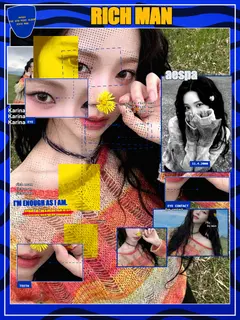
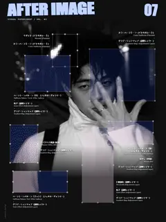
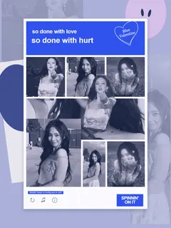
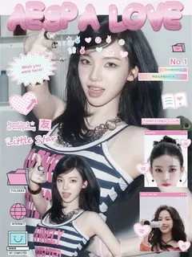
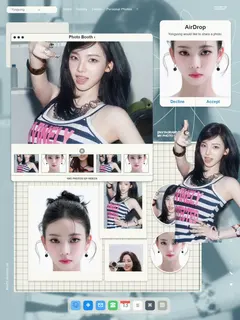
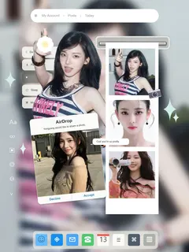
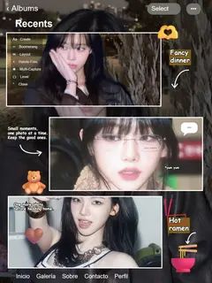
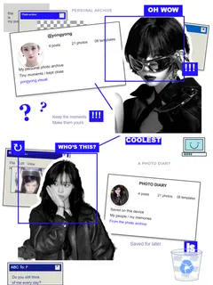

# Yongyong Visual Lab · demo2.0

**把照片变成拼贴海报，也把喜欢的色彩留成滤镜配方。**

Yongyong Visual Lab 是一个在浏览器里使用的照片创作工具。上传一张或多张照片，从八组拼贴模板开始，用 REMIX 尝试不同排版与调色，再调整文字、照片框、贴纸和局部细节，导出自己的作品。

**[打开网站，开始创作 →](https://cyjaster.github.io/Yongyong-Visual-Lab/#showcase)** · [查看八组模板作品](https://cyjaster.github.io/Yongyong-Visual-Lab/samples/results/template-function-acceptance/20261010/index.html)

无需注册、安装或 API Key。照片处理在当前浏览器本地完成，不会上传到服务器。

## 两个创作空间

### Collage Poster · 拼贴海报

从电光杂志到粉色桌面、照片日记与相册手账，把单张照片或多张素材组合成自己的海报。

- **八组模板**：直接套用构图，再编辑照片、文字、窗口、贴纸与背景。
- **三种 REMIX**：总 REMIX 同时切换排版和调色；排版 REMIX 只换构图；滤镜 REMIX 只换调色。三者都保留当前图片。
- **自由编辑**：拖动、缩放、旋转、调整图层顺序；用索引框放大照片局部，单独设置效果。
- **本地人像抠图**：选中照片后自动抠出人像，也能恢复原背景。
- **草稿与历史**：自动保存当前浏览器中的海报草稿，支持撤销和重做。
- **高清 PNG**：按所选尺寸导出，3:4 海报最高支持 3000 × 4000。

### Filter Lab · 滤镜配方卡

上传照片，叠加颜色图层，调整混合模式与透明度，对比原图和效果图。将照片、色层参数与标题排成配方卡，导出 PNG；调色配方也可以保存为 JSON，再导入继续使用。

## 作品预览

下面是网站内置的示范 01—08，与编辑器「示范作品」中的预览一致。模板是创作起点，照片、文字和细节都可以继续修改。

<table>
  <tr>
    <td align="center"><br>01 · Aespa 电光档案</td>
    <td align="center"><br>02 · AFTER IMAGE</td>
    <td align="center"><br>03 · Blue Valentine</td>
    <td align="center"><br>04 · Pink Desktop</td>
  </tr>
  <tr>
    <td align="center"><br>05 · Photo Booth</td>
    <td align="center"><br>06 · AirDrop Diary</td>
    <td align="center"><br>07 · After Hours Album</td>
    <td align="center"><br>08 · Electric Blue Archive</td>
  </tr>
</table>

| 模板 | 视觉方向 |
| --- | --- |
| 01 · Aespa 电光档案 | 蓝黄撞色、杂志拼贴与局部索引 |
| 02 · AFTER IMAGE | 黑白底图、透明选区与多种局部特效 |
| 03 · Blue Valentine | 蓝紫封套、照片格与独立人像前景 |
| 04 · Pink Desktop | 粉色窗口、气球字与桌面贴纸 |
| 05 · Photo Booth | 海蓝照片桌面、照片窗口与网格纸 |
| 06 · AirDrop Diary | 柔焦背景、照片条与分享窗口 |
| 07 · After Hours Album | 深色相册、错位照片与手账贴纸 |
| 08 · Electric Blue Archive | 电蓝索引、复古窗口与个人照片档案 |

## 开始使用

1. **进入编辑**：打开网站后先看到立体彩卡展示，点击「进入编辑」；电脑也可以双击作品。
2. **选择素材**：上传自己的照片。想先体验，可展开左侧「示范作品」选择模板。
3. **尝试方案**：用三个 REMIX 保留自己的照片并切换方案。示范按钮会载入内置照片，已有作品时请留意替换确认。
4. **调整细节**：点击画布中的对象，在右侧「外观 / 布局 / 高级」修改。详细设置默认折叠，点击标题展开。
5. **保存作品**：选择分辨率并导出 PNG，也可以返回展示查看当前作品。

没有本地草稿时，首次展示默认采用 **05 · Photo Booth**；已有海报草稿时优先恢复自己的作品。

## demo2.0 · 界面更新

- **立体彩卡展示**：打开网站先看作品，进入编辑后继续创作，随时返回展示。
- **水银背景与磨砂面板**：背景流动、纸边与高光构成立体展台，两种创作模式共用界面动效开关。
- **更紧凑的编辑界面**：详细设置按需展开，画布 FIT 跟随可用空间调整。
- **首屏按需加载**：示范照片与 Filter Lab 预设按需读取，固定示范复用预处理人像。

展示的倾斜、投影、高光和界面背景只用于预览，不会进入作品 PNG。手机体感依赖浏览器权限与设备传感器，实体手机兼容性和功耗仍待验证。

## 使用须知

- **草稿保存在当前浏览器和站点地址下**，不跨设备同步；清理站点数据会丢失，重要作品请及时导出。
- **首次抠图需要加载本站模型**，等待时间取决于网络与设备；处理中的照片仍留在本机。
- **照片决定构图适配**：人物姿态与原图清晰度不会由模板生成；局部索引框需要按照片手动调整。
- **示范窗口是海报元素**：AirDrop 的 Accept / Decline 等按钮不执行实际分享。
- 请使用有权使用的图片。示范作品用于展示模板效果。

## 本地运行

仓库是 HTML、CSS 与原生 JavaScript 构成的静态网站，无需构建。克隆或下载后，在仓库根目录运行：

```sh
node checks/serve-local.cjs
```

打开 [http://127.0.0.1:8089/#showcase](http://127.0.0.1:8089/#showcase)。Windows 也可以双击 `打开网站.cmd`，需要已安装 Node.js。

完整功能需要 HTTP / HTTPS，请通过本地服务打开；直接双击 `index.html` 会限制图片读取与抠图功能。

## 项目文档

- [操作验收与测试说明](TESTING.md)
- [开发记录](DEVELOPMENT_LOG.md) · [当前项目节点](CHECKPOINT.md)
- [界面整合与发布记录](RELEASE_20261013.md)
- [设计参考](references/README.md) · [示例图库说明](samples/README.md)

部分历史截图与测试输出仅保存在开发者本地；在线作品请以本文链接的模板展示页为准。
